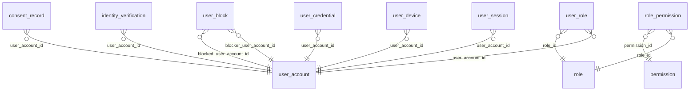
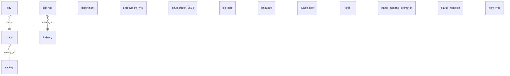
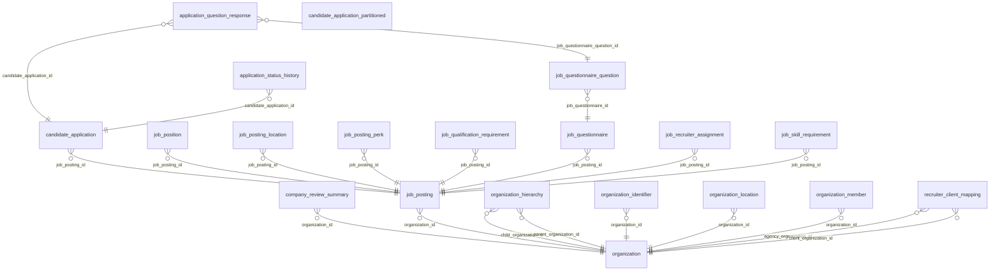
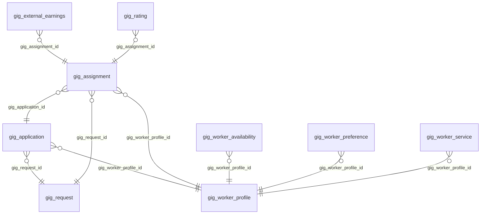
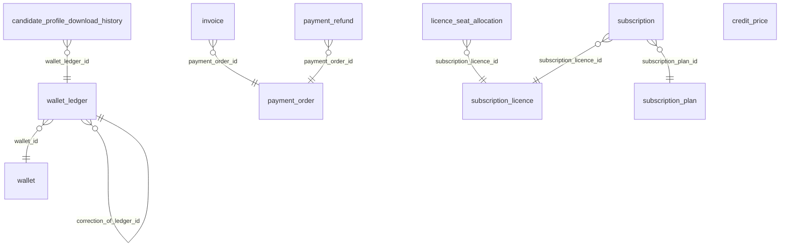
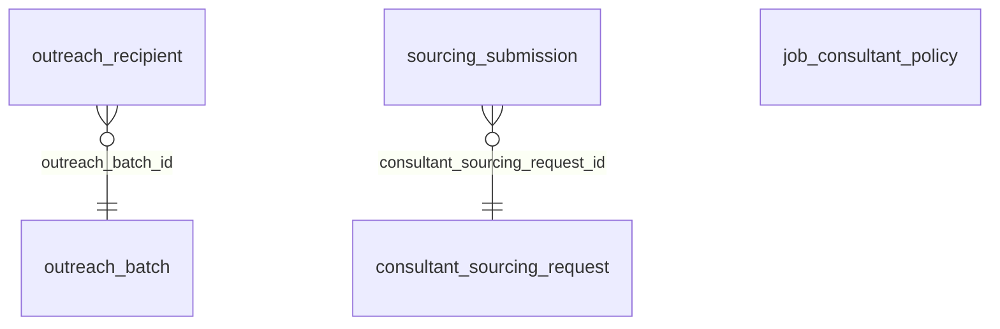
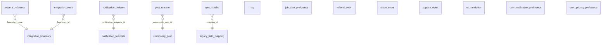
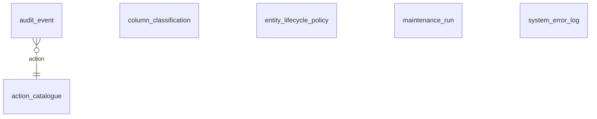
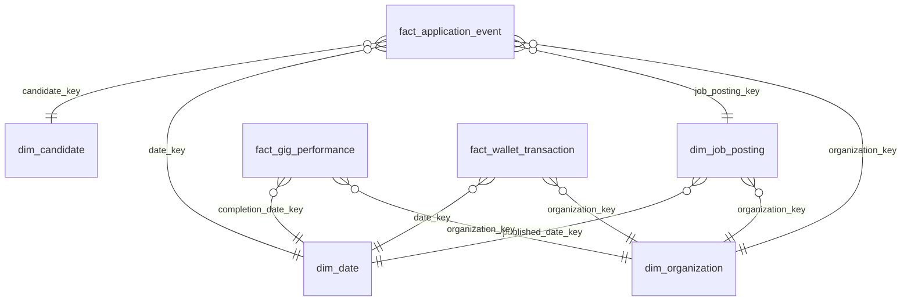

# Talentra: Entity-Relationship Diagrams, generated (Step 09)

**Phase:** 2 Model | **Step:** 09 Database, Tables and Relationships
**Generated** by `scripts/lifecycle/gen_model_catalogues.py`. Do not hand-edit.

One diagram per schema showing its tables and the foreign keys between them; foreign keys that cross schemas are listed in a table instead, to keep each diagram readable. Columns are omitted: see the attribute catalogue. `}o--||` reads: many rows on the left reference one row on the right. Audit columns (`created_by`, `updated_by`, `deleted_by`) point at `core.user_account` from nearly every table and are left out of the diagrams.

## `core` (11 tables)

## `master` (15 tables)

## `profile` (22 tables)

```mermaid
erDiagram
    candidate_activity_log }o--|| candidate_profile : "candidate_profile_id"
    candidate_assessment_score }o--|| candidate_assessment : "candidate_assessment_id"
    candidate_assessment_score }o--|| candidate_profile : "candidate_profile_id"
    candidate_diversity_profile }o--|| candidate_profile : "candidate_profile_id"
    candidate_document }o--|| candidate_profile : "candidate_profile_id"
    candidate_document }o--|| resume_template : "resume_template_id"
    candidate_education }o--|| candidate_profile : "candidate_profile_id"
    candidate_job_preference }o--|| candidate_profile : "candidate_profile_id"
    candidate_language }o--|| candidate_profile : "candidate_profile_id"
    candidate_location }o--|| candidate_profile : "candidate_profile_id"
    candidate_profile_completion }o--|| candidate_profile : "candidate_profile_id"
    candidate_project }o--|| candidate_profile : "candidate_profile_id"
    candidate_search_document }o--|| candidate_profile : "candidate_profile_id"
    candidate_search_history }o--|| candidate_profile : "candidate_profile_id"
    candidate_skill }o--|| candidate_profile : "candidate_profile_id"
    candidate_work_experience }o--|| candidate_profile : "candidate_profile_id"
    course_enrolment }o--|| candidate_profile : "candidate_profile_id"
    course_enrolment }o--|| course : "course_id"
    profile_view_history }o--|| candidate_profile : "candidate_profile_id"
    recruiter_bookmark }o--|| candidate_profile : "candidate_profile_id"
    recruiter_search
```

## `recruitment` (20 tables)

## `gig` (9 tables)

## `commercial` (11 tables)

## `sourcing` (5 tables)

## `messaging` (17 tables)

## `audit` (6 tables)

## `analytics` (7 tables)

## Foreign keys across schemas

90 relationships (audit-column references excluded).

| From | Column | To |
|:--|:--|:--|
| `audit.audit_event` | `actor_user_account_id` | `core.user_account` |
| `audit.audit_event` | `impersonator_user_account_id` | `core.user_account` |
| `audit.audit_event` | `organization_id` | `recruitment.organization` |
| `audit.system_error_log` | `user_account_id` | `core.user_account` |
| `commercial.candidate_profile_download_history` | `downloader_user_account_id` | `core.user_account` |
| `commercial.candidate_profile_download_history` | `candidate_profile_id` | `profile.candidate_profile` |
| `commercial.candidate_profile_download_history` | `organization_id` | `recruitment.organization` |
| `commercial.invoice` | `organization_id` | `recruitment.organization` |
| `commercial.licence_seat_allocation` | `allocated_by_user_account_id` | `core.user_account` |
| `commercial.licence_seat_allocation` | `user_account_id` | `core.user_account` |
| `commercial.payment_order` | `user_account_id` | `core.user_account` |
| `commercial.payment_order` | `organization_id` | `recruitment.organization` |
| `commercial.subscription_licence` | `organization_id` | `recruitment.organization` |
| `commercial.wallet` | `organization_id` | `recruitment.organization` |
| `core.user_block` | `blocked_organization_id` | `recruitment.organization` |
| `gig.gig_rating` | `rater_user_account_id` | `core.user_account` |
| `gig.gig_request` | `organization_id` | `recruitment.organization` |
| `gig.gig_worker_preference` | `organization_id` | `recruitment.organization` |
| `gig.gig_worker_profile` | `user_account_id` | `core.user_account` |
| `gig.gig_worker_service` | `skill_id` | `master.skill` |
| `messaging.community_post` | `author_user_account_id` | `core.user_account` |
| `messaging.community_post` | `content_language_code` | `master.language` |
| `messaging.job_alert_preference` | `user_account_id` | `core.user_account` |
| `messaging.job_alert_preference` | `city_id` | `master.city` |
| `messaging.job_alert_preference` | `job_role_id` | `master.job_role` |
| `messaging.job_alert_preference` | `work_type_id` | `master.work_type` |
| `messaging.notification_delivery` | `recipient_user_account_id` | `core.user_account` |
| `messaging.post_reaction` | `user_account_id` | `core.user_account` |
| `messaging.referral_event` | `referred_user_account_id` | `core.user_account` |
| `messaging.referral_event` | `referrer_user_account_id` | `core.user_account` |
| `messaging.share_event` | `user_account_id` | `core.user_account` |
| `messaging.share_event` | `job_posting_id` | `recruitment.job_posting` |
| `messaging.support_ticket` | `assigned_agent_user_id` | `core.user_account` |
| `messaging.support_ticket` | `requester_user_account_id` | `core.user_account` |
| `messaging.ui_translation` | `language_code` | `master.language` |
| `messaging.user_notification_preference` | `user_account_id` | `core.user_account` |
| `messaging.user_privacy_preference` | `user_account_id` | `core.user_account` |
| `profile.candidate_activity_log` | `user_account_id` | `core.user_account` |
| `profile.candidate_assessment` | `skill_id` | `master.skill` |
| `profile.candidate_education` | `qualification_id` | `master.qualification` |
| `profile.candidate_language` | `language_id` | `master.language` |
| `profile.candidate_location` | `city_id` | `master.city` |
| `profile.candidate_profile` | `user_account_id` | `core.user_account` |
| `profile.candidate_profile` | `summary_language_code` | `master.language` |
| `profile.candidate_skill` | `skill_id` | `master.skill` |
| `profile.candidate_work_experience` | `department_id` | `master.department` |
| `profile.candidate_work_experience` | `employment_type_id` | `master.employment_type` |
| `profile.candidate_work_experience` | `job_role_id` | `master.job_role` |
| `profile.profile_view_history` | `viewer_user_account_id` | `core.user_account` |
| `profile.profile_view_history` | `organization_id` | `recruitment.organization` |
| `profile.recruiter_bookmark` | `user_account_id` | `core.user_account` |
| `profile.recruiter_bookmark` | `organization_id` | `recruitment.organization` |
| `profile.recruiter_search` | `user_account_id` | `core.user_account` |
| `profile.recruiter_search` | `organization_id` | `recruitment.organization` |
| `recruitment.application_status_history` | `changed_by_user_account_id` | `core.user_account` |
| `recruitment.candidate_application` | `assigned_recruiter_user_account_id` | `core.user_account` |
| `recruitment.candidate_application` | `candidate_document_id` | `profile.candidate_document` |
| `recruitment.candidate_application` | `candidate_profile_id` | `profile.candidate_profile` |
| `recruitment.job_position` | `filled_by_candidate_profile_id` | `profile.candidate_profile` |
| `recruitment.job_posting` | `city_id` | `master.city` |
| `recruitment.job_posting` | `department_id` | `master.department` |
| `recruitment.job_posting` | `employment_type_id` | `master.employment_type` |
| `recruitment.job_posting` | `industry_id` | `master.industry` |
| `recruitment.job_posting` | `job_role_id` | `master.job_role` |
| `recruitment.job_posting` | `description_language_code` | `master.language` |
| `recruitment.job_posting` | `work_type_id` | `master.work_type` |
| `recruitment.job_posting_location` | `city_id` | `master.city` |
| `recruitment.job_posting_perk` | `job_perk_id` | `master.job_perk` |
| `recruitment.job_qualification_requirement` | `qualification_id` | `master.qualification` |
| `recruitment.job_recruiter_assignment` | `assigned_by_user_account_id` | `core.user_account` |
| `recruitment.job_recruiter_assignment` | `recruiter_user_account_id` | `core.user_account` |
| `recruitment.job_skill_requirement` | `skill_id` | `master.skill` |
| `recruitment.organization` | `country_id` | `master.country` |
| `recruitment.organization_identifier` | `verified_by_user_account_id` | `core.user_account` |
| `recruitment.organization_identifier` | `country_id` | `master.country` |
| `recruitment.organization_location` | `city_id` | `master.city` |
| `recruitment.organization_member` | `invited_by_user_account_id` | `core.user_account` |
| `recruitment.organization_member` | `user_account_id` | `core.user_account` |
| `recruitment.recruiter_client_mapping` | `recruiter_user_account_id` | `core.user_account` |
| `sourcing.consultant_sourcing_request` | `consultant_user_account_id` | `core.user_account` |
| `sourcing.consultant_sourcing_request` | `decided_by_user_account_id` | `core.user_account` |
| `sourcing.consultant_sourcing_request` | `job_posting_id` | `recruitment.job_posting` |
| `sourcing.job_consultant_policy` | `job_posting_id` | `recruitment.job_posting` |
| `sourcing.outreach_batch` | `job_posting_id` | `recruitment.job_posting` |
| `sourcing.outreach_batch` | `organization_id` | `recruitment.organization` |
| `sourcing.outreach_recipient` | `candidate_profile_id` | `profile.candidate_profile` |
| `sourcing.sourcing_submission` | `submitted_by_user_account_id` | `core.user_account` |
| `sourcing.sourcing_submission` | `candidate_profile_id` | `profile.candidate_profile` |
| `sourcing.sourcing_submission` | `candidate_application_id` | `recruitment.candidate_application` |
| `sourcing.sourcing_submission` | `job_posting_id` | `recruitment.job_posting` |
