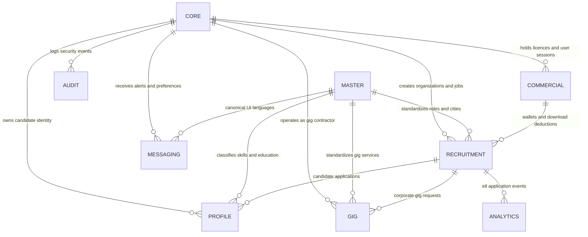
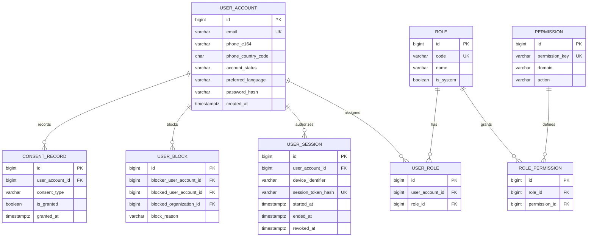
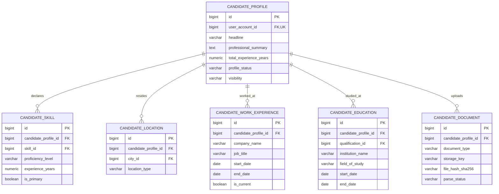
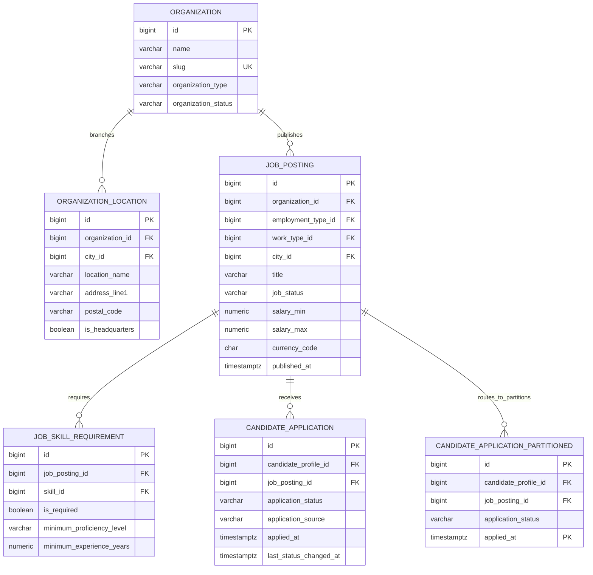
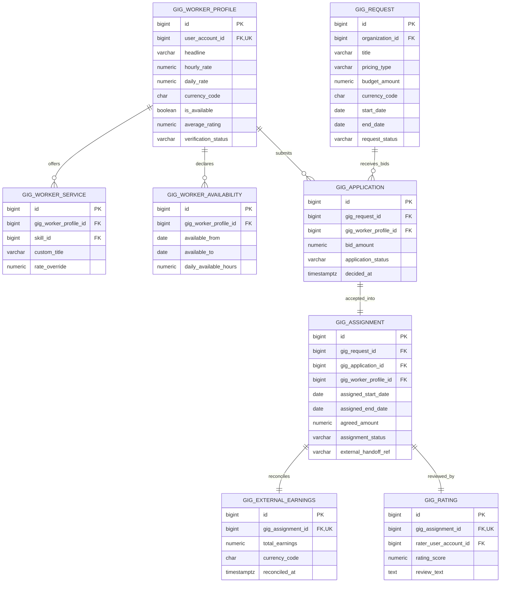
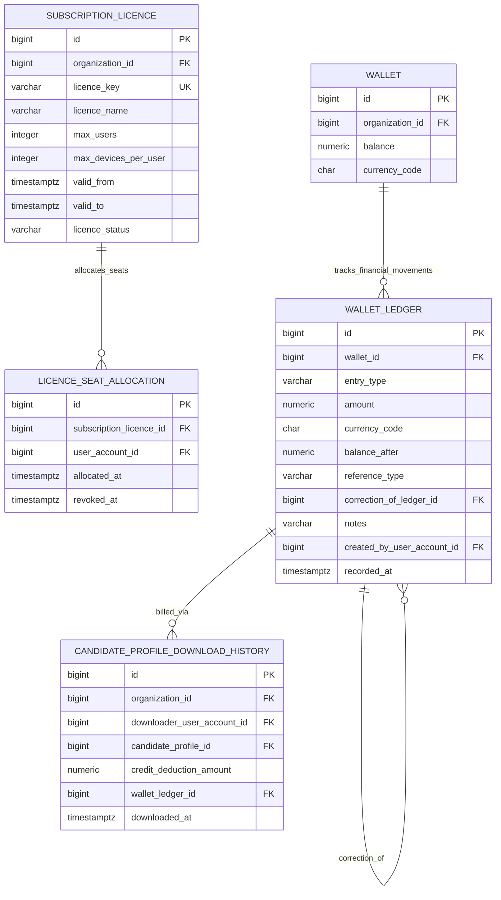
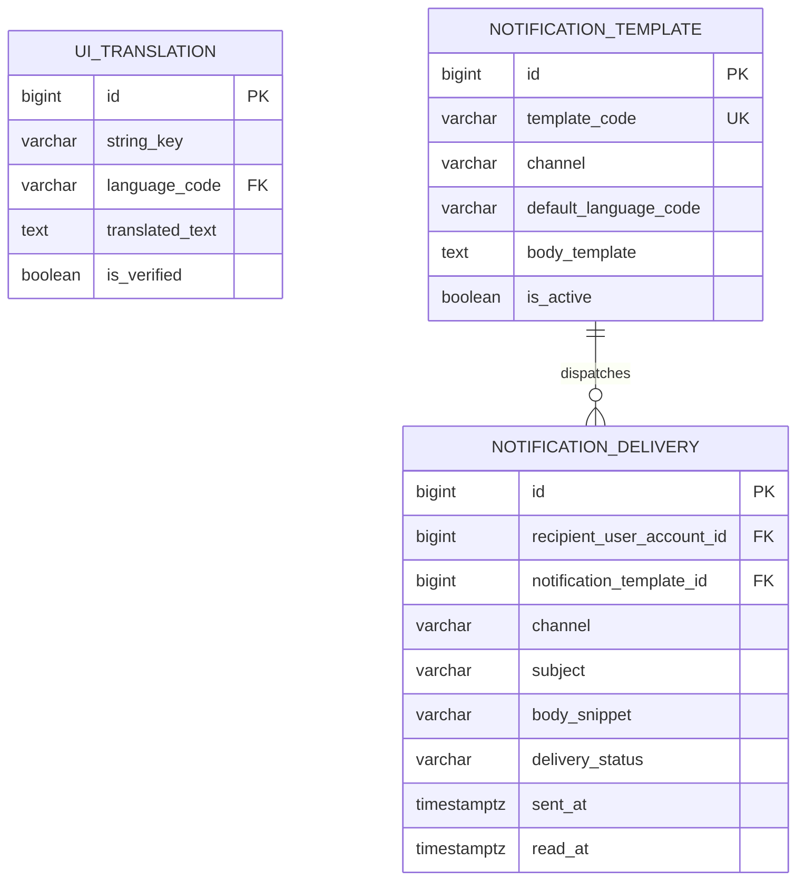
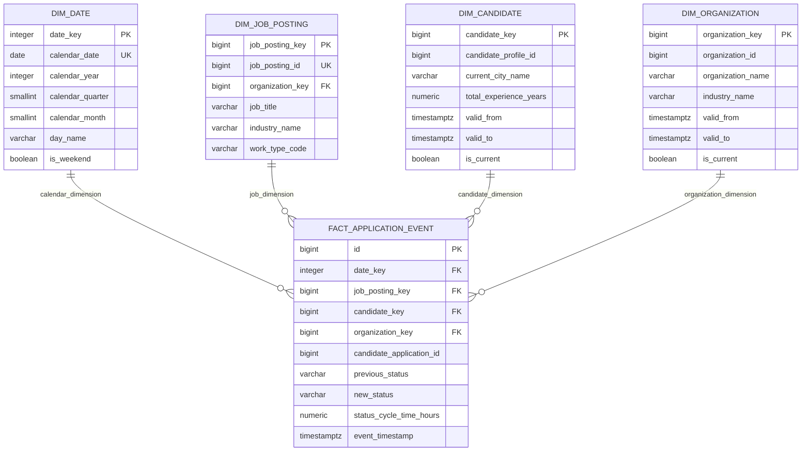

# Talentra Entity-Relationship (ER) Architecture

> **Partly superseded (2026-10-27).** This diagram was drawn for migrations 001-019. Tables added by 020-027 are not in it. The generated diagrams, one per schema and always current, are in [`09-er-diagram-generated.md`](09-er-diagram-generated.md).
**Database Engine**: PostgreSQL 17  
**Schema Architecture**: 10 Isolated Domain Schemas  
**Notation**: Mermaid Crow's Foot Relational Diagrams  

---

## 1. High-Level Domain Boundary Architecture

---

## 2. Core Identity, Security & RBAC Domain (`core`)

---

## 3. Candidate Profile & Career Extensions (`profile`)

---

## 4. Recruitment, Job Postings & Applications (`recruitment`)

---

## 5. Gig Marketplace Subsystem (`gig`)

---

## 6. Commercial Licences, Subscriptions & Append-Only Wallets (`commercial`)

---

## 7. Messaging & Multilingual UI Translations (`messaging`)

---

## 8. Analytics Star Schema Marts (`analytics`)

